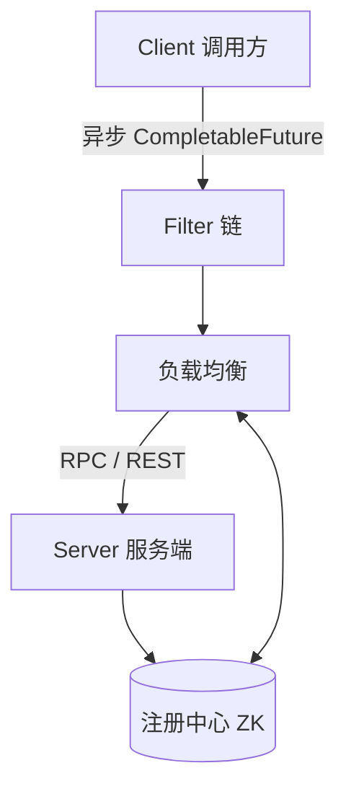

<div align="center">

# abg-cloud

**一款异步响应式 RPC 框架**

[](LICENSE)
[](https://github.com/annabergite/abg-cloud/stargazers)
[](https://www.java.com/)
[](https://spring.io/projects/spring-boot)

</div>

## ✨ 功能特点

- ⚡ **纯异步**：仅支持异步调用，Service 接口所有 `public` 方法返回值都必须为 `CompletableFuture`
- 🎯 **接口即配置**：配置定义在 Service 接口上而非实现类上，实现者和调用者都无需引入额外注解
- 🌐 支持 REST 调用
- 🛡️ 支持失败回退、熔断、心跳、自动重连
- 🔌 支持自定义服务注册、负载均衡、序列化
- 🔗 支持 Filter 机制，可基于此实现 Tracing、限流限速、黑白名单等功能
- 🧩 支持 Spring Boot

## 🏗️ 架构（简化）



## 🚀 Quick Start

Maven 依赖：

```xml
<!-- 必须引入 -->
<dependency>
    <groupId>com.abg-cloud</groupId>
    <artifactId>abg-cloud</artifactId>
    <version>0.0.9</version>
</dependency>

<!-- 序列化方式，kryo protostuff 两个中任选一个 -->
<dependency>
    <groupId>com.abg-cloud</groupId>
    <artifactId>abg-kryo</artifactId>
    <version>0.0.9</version>
</dependency>

<!-- 序列化方式，kryo protostuff 两个中任选一个 -->
<dependency>
    <groupId>com.abg-cloud</groupId>
    <artifactId>abg-protostuff</artifactId>
    <version>0.0.9</version>
</dependency>

<!-- zk注册中心，可选引入 -->
<dependency>
    <groupId>com.abg-cloud</groupId>
    <artifactId>abg-register-zk</artifactId>
    <version>0.0.9</version>
</dependency>

<!-- SpringBoot集成，可选引入 -->
<dependency>
    <groupId>com.abg-cloud</groupId>
    <artifactId>abg-spring-boot-starter</artifactId>
    <version>0.0.9</version>
</dependency>
```

**1. 定义接口**

```java
@AbgService(version = "1.0.0")
public interface HelloService {

	@AbgService(version = "1.0.0", rest = "hello")
	default CompletableFuture<String> hello(String msg) {
		// default 实现会自动注册为失败回退方法，当远程调用失败时执行
		return CompletableFuture.completedFuture("error");
	}
}
```

**2. 服务端实现接口**

```java
@Component
public class HelloServiceImpl implements HelloService {
	@Override
	public CompletableFuture<String> hello(String msg) {
		return CompletableFuture.completedFuture(msg);
	}
}
```

**3. 配置 `abg-server.conf`**，声明服务器地址、序列化协议、注册地址等信息。

**4. 服务端启动**

```java
@SpringBootApplication(scanBasePackages = { "com.hello" })
@EnableabgServer
public class TruboServerBootTest {
	public static void main(String[] args) {
		SpringApplication.run(TruboServerBootTest.class, args);
	}
}
```

**5. 客户端调用**

```java
@Component
public class HelloReferTest {
	@Autowired
	HelloService helloService;

	public void doSomeThing(String msg) {
		helloService.hello(msg)
			.thenAccept(message -> System.out.println(message));
	}
}
```

**6. 配置 `abg-client.conf`**，声明服务器地址、序列化协议、注册地址等信息。

**7. 客户端启动**

```java
@SpringBootApplication(scanBasePackages = { "com.hello" })
@EnableabgClient
public class HelloBootTest {
	public static void main(String[] args) {
		SpringApplication.run(HelloBootTest.class, args);
	}
}
```

## 📖 技术原理

- [如何编写高性能的 RPC 框架](https://www.jianshu.com/p/7182b8751e75)
- [RPC 异步响应式调用](https://www.jianshu.com/p/1e406ffa5f90)

## 📄 License

[Apache-2.0](LICENSE) © annabergite
